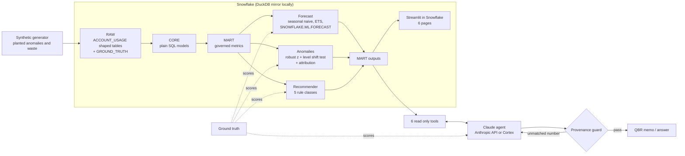
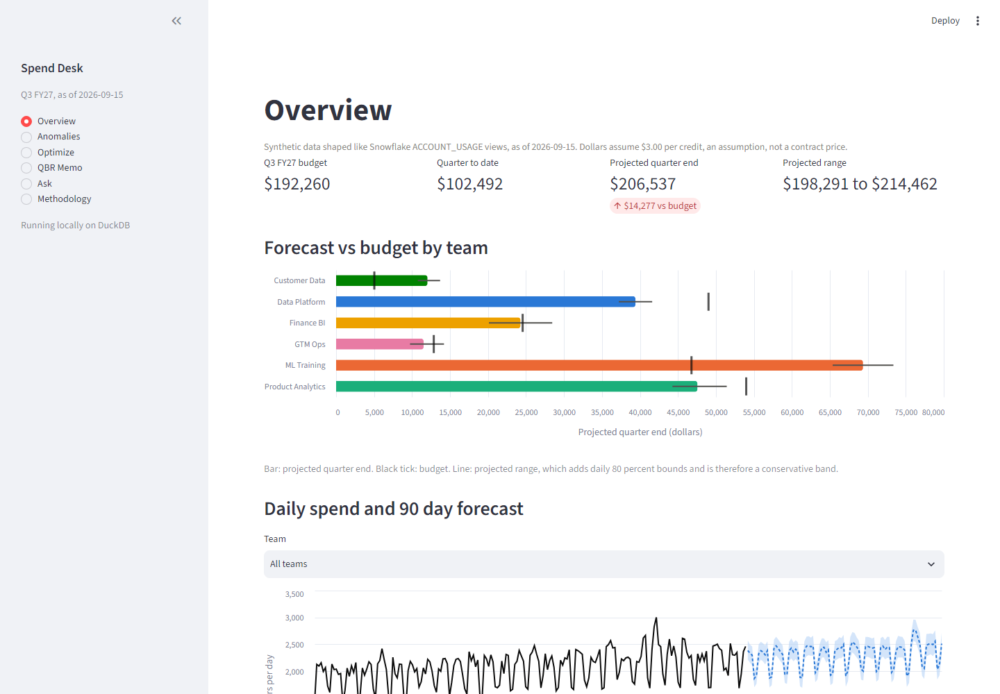
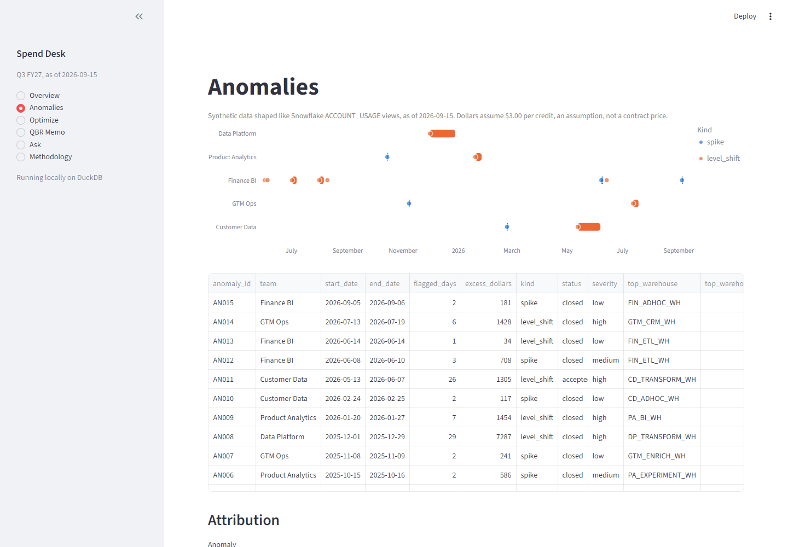
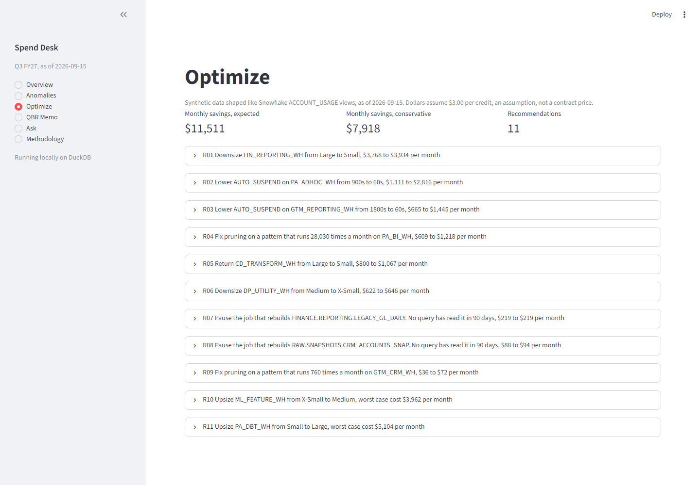
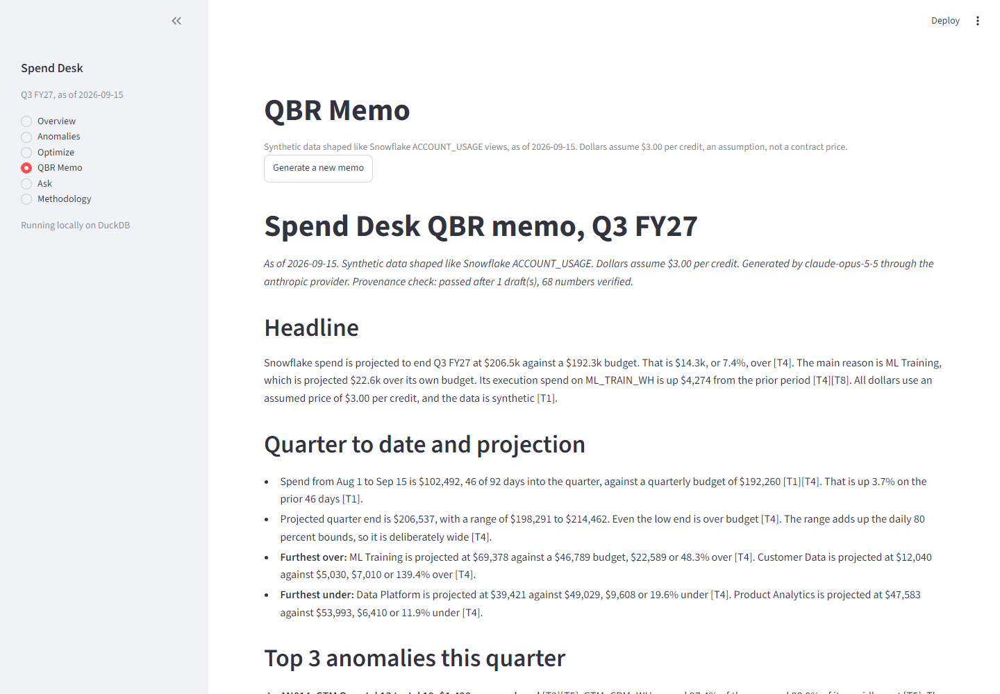

# Spend Desk

An agentic cloud spend copilot that runs on Snowflake. It forecasts credit spend per team, flags cost anomalies and explains them, recommends warehouse optimizations with exact SQL, and drafts a QBR memo for Engineering and Finance leaders where every number is checked against the tool that produced it.

> **All data is synthetic.** It is shaped like Snowflake's `ACCOUNT_USAGE` views but describes a fictional company with 6 teams and 25 warehouses. It is not real customer data and not internal Snowflake data. The generator plants known anomalies and known waste, so every result below is a score against ground truth, not an estimate.

## The problem

A Finance BI team that owns cloud spend has to answer the same questions every quarter. Where will we land against budget? What spiked, and who caused it? What can we turn off? The answers live in raw metering, query, and event logs that nobody reads by hand, and the QBR narrative is usually written from a spreadsheet after the fact. Spend Desk turns those logs into a governed metric layer, a backtested forecast, an anomaly detector that knows the difference between a runaway loop and a planned launch, and a rule engine whose savings estimates are scored against the real answer. A Claude agent then writes the memo, but it can only quote numbers it got from tools, and a provenance guard rejects any draft that does otherwise.

## Results

Every number here comes from `make eval` (`results/eval_summary.json`) or the agent eval (`results/agent_eval.json`), as of 2026-09-15.

| Area | Metric | Result |
|---|---|---|
| Forecast, company total | Daily MAPE, 90 day horizon, 6 rolling origins | **5.5%** vs 8.3% for seasonal naive |
| Forecast, by team | Teams where the chosen model beats seasonal naive | **6 of 6** (mean MAPE 13.4% vs 16.4%) |
| Anomaly detection, held out window | Precision / recall against planted anomalies | **80% / 71%** (5 of 7), median 0 days to detect |
| Anomaly detection, held out window | `SNOWFLAKE.ML.ANOMALY_DETECTION` benchmark | 60% / 43% (3 of 7) |
| Recommender | Share of planted waste found | **11 of 11 (100%)**, 0 false recommendations |
| Recommender | Expected savings vs planted savings | $11,511 vs $11,100 a month (104%), median per item error 41% |
| Agent | Answer accuracy on 15 ground truth questions | **93% (14 of 15)** |
| Agent | Provenance pass rate (final / first draft) | **100% / 67%**, 286 numbers checked |
| Data quality | Checks passing | 7 of 7 |
| Tests | pytest | 52 passing |

The whole build used 0.95 Snowflake credits on an XSMALL warehouse with a 25 credit resource monitor. The agent eval and memo cost about $1.33 in Anthropic API usage.

## Architecture



## Screenshots

| Overview | Anomalies |
|---|---|
|  |  |
| **Optimize** | **QBR memo** |
|  |  |

A full generated memo is in [docs/sample_qbr_memo.md](docs/sample_qbr_memo.md).

## How it works

**Synthetic data (`src/spend_desk/generate`).** Each warehouse runs a set of query patterns (dashboards, nightly batch, continuous loads). Hour by hour, query counts drive busy time, idle time kept up by `AUTO_SUSPEND`, resumes with the 60 second minimum, queueing, spill, and credits, so metering, events, and the 10 percent query history sample all agree. Every planted item is simulated twice, with and without it, using the same random draws. The difference is its true dollar impact. There are 14 anomalies across 6 types, 11 waste items across 5 types, and 3 planned onboarding changes.

**Governed metric layer (`sql/`, `metrics.yaml`).** Plain SQL that runs unchanged on DuckDB and Snowflake. Every metric is defined once with owner, formula, grain, and caveats. Idle credits are compute minus `CREDITS_ATTRIBUTED_COMPUTE_QUERIES`, and the 60 second minimum on each resume is split out because no setting can remove it.

**Forecast (`forecast.py`).** A rolling origin backtest picks the model per team. Snowflake ML wins for the company total and 3 teams, ETS wins for the other 3. A budget set on 2026-01-31 from trailing run rates gives the headline: Q3 FY27 projected at $206,537 against a $192,260 budget.

**Anomalies (`anomaly.py`).** Expected spend is the median of the same weekday over the last 4 reference weeks, with a learned uplift for month end close. Days are scored with a robust z score (median and MAD). A level shift test catches sustained rises that no single day makes obvious. Flagged days stay out of the baseline, so an unconfirmed shift keeps alerting, and an owner annotation turns a confirmed shift into the new baseline. Each anomaly's gap is split by warehouse, cost type, query pattern, and user, using the same reference days so the parts add up.

**Recommender (`recommend.py`).** Five rule classes, each with a detection query, evidence, a conservative and an expected savings formula, a confidence level, and an exact `ALTER WAREHOUSE` statement or scheduling change. Upsizing is shown as a cost range next to the queueing it removes.

**Agent (`src/spend_desk/agent`).** Claude (`claude-opus-5-5`) can only touch data through six tools: `get_spend_summary`, `get_forecast_vs_budget`, `list_anomalies`, `explain_anomaly`, `list_recommendations`, `get_metric_definition`. Every tool result carries a citation id. The provenance guard extracts every number from a draft, works out its displayed precision, and requires a match in the output of a tool cited on the same line. Drafts that fail are sent back with the exact problems, up to 3 times, and every check is logged.

## Run it

Locally, no Snowflake account needed:

```bash
python -m venv .venv && .venv/Scripts/activate      # Python 3.11
pip install -e ".[dev]"
make data        # generate RAW and the DuckDB mirror (about 2 minutes)
make eval        # build models, forecast, anomalies, recommendations, write results/
make test
streamlit run app/streamlit_app.py
```

`make` is optional. Every target is `python -m spend_desk <command>`. The agent needs `ANTHROPIC_API_KEY` in `.env` (see `.env.example`), then `make agent-eval` (about $1.50) or `python -m spend_desk ask "Why did ML Training spike in week 32?"`.

On Snowflake:

```bash
python -m spend_desk bootstrap                          # sql/bootstrap/00_bootstrap.sql
make load                                               # RAW to Snowflake
make build-sf                                           # CORE and MART
python -m spend_desk forecast --target snowflake        # add --snowflake-ml to retrain (about 0.5 credits)
python -m spend_desk anomaly --target snowflake
python -m spend_desk recommend --target snowflake
make deploy                                             # sync agent outputs, create the Streamlit app
```

The bootstrap creates an XSMALL warehouse with `AUTO_SUSPEND = 60`, a 600 second statement timeout, and a resource monitor that suspends at 25 credits a month.

## Honest limitations

- **Synthetic data, shared assumptions.** The recommender's expected auto suspend savings use the same query arrival model the generator uses to create idle time, so that estimate is closer to the truth here than it would be on a real account. The 41% median per item savings error is the more realistic signal.
- **Two detector changes after a first look at held out results.** After seeing one held out run, I added an explicit level shift test (validation had already missed A06) and judged shifts on 7 day cost instead of a single day. A third change, requiring the flagged day itself to be elevated, was motivated by false alarms in validation. Thresholds were always tuned on validation only. The detector was then frozen.
- **What the detector misses.** It missed A08, a two day retry loop on ML Training, whose daily spend is too volatile for that spike to stand out, and A09, a subtle weekend on a dashboard warehouse. Snowflake ML caught A08. When two shifts overlap on one team, confirming one absorbs the other: confirming the Customer Data launch (A13) also hid an upsized warehouse (A10). The recommender still flags that warehouse (R05).
- **Cortex is blocked on trial accounts.** `AI_COMPLETE` returns "not available for trial accounts" for every model, so the deployed app shows the memo and agent answers generated locally through the Anthropic API with the same tools and guard. The Cortex provider is implemented but has not been run.
- **Warehouse settings.** No `ACCOUNT_USAGE` view holds `AUTO_SUSPEND` or cluster counts, so `RAW.WAREHOUSES_SNAPSHOT` is shaped like `SHOW WAREHOUSES` output on the as of date.
- **Sampling.** `QUERY_HISTORY` is a uniform 10% sample, so the unused output rule could miss a rare reader. It recommends confirming with the owner before dropping anything.
- **Forecast ranges.** Interval coverage ranges from 47% to 98% by team against an 80% target, and the projected quarter range adds daily bounds, so it is a conservative band, not a true 80% interval.
- **Provenance guard scope.** Dates, fiscal labels, identifiers, and whole numbers from 0 to 10 are not checked, because the memo uses them as labels and counts.
- **Grading.** One of 15 agent answers was marked wrong because it wrote "Aug" where the grader required "August". The number was right. I left the grader unchanged after seeing results.

## Repository map

```
sql/bootstrap      Snowflake setup script
sql/models         CORE and MART models (plain SQL, both engines)
sql/tests          data quality checks (zero rows means pass)
sql/views          forecast vs budget
src/spend_desk     generator, runner, forecast, anomaly, recommend, agent, deploy, eval
app                Streamlit app (Snowflake or local)
seeds              owner annotations for expected changes
results            evaluation outputs and cached Snowflake ML results
docs               sample memo, demo script, screenshots
```
